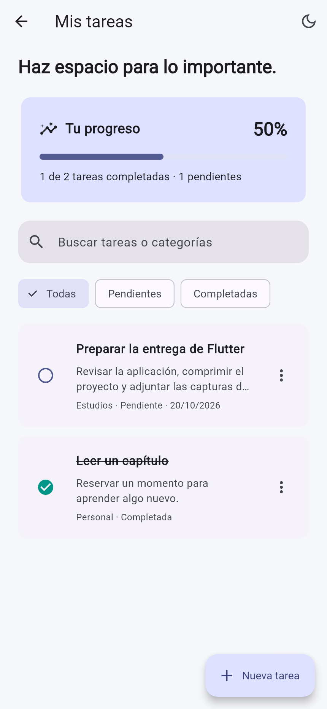
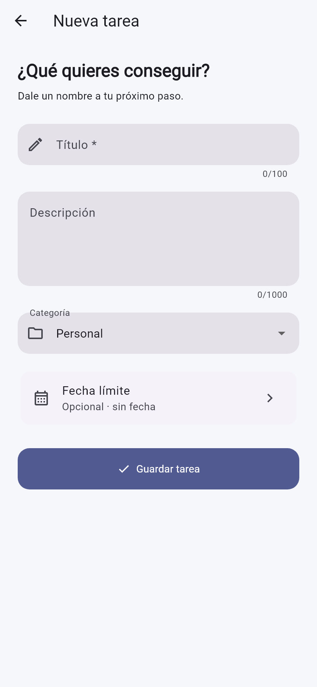

# To Do List · Flutter

Aplicación académica en español para organizar tareas, con Flutter, Material 3 y persistencia local.

## Contexto y ayuda de IA

Este repositorio recoge un trabajo académico de Desarrollo de Aplicaciones Multiplataforma. La implementación inicial se generó con asistencia sustancial de IA a partir del enunciado de clase.

## Funciones implementadas

- Crear, consultar, editar, completar y eliminar tareas, con confirmación antes del borrado.
- Título y descripción, categorías Personal/Estudios/Trabajo y fecha límite opcional.
- Búsqueda y filtros por estado, porcentaje completado y mensajes de lista vacía.
- Modo oscuro y guardado de las tareas y del tema mediante SharedPreferences.
- Navegación entre bienvenida, lista, formulario y detalle.

## Ejecutar

Requiere Flutter con una versión de Dart compatible con `sdk: ^3.13.4`, según `pubspec.yaml`.

```sh
flutter pub get
flutter run -d chrome
```

La carpeta incluye configuraciones para web, Android y Windows. Las versiones Android y Windows no se han compilado ni ejecutado en un dispositivo durante esta revisión; requieren su entorno de desarrollo correspondiente.

## Estructura

- `lib/models/task.dart`: modelo y conversión JSON.
- `lib/state/task_store.dart`: estado compartido y almacenamiento local.
- `lib/screens/`: bienvenida, lista, formulario y detalle.
- `test/widget_test.dart`: pruebas de persistencia y del flujo de interacción.
- `test/screenshots_test.dart`: generación reproducible de capturas de widgets.
- `entrega/capturas/`: siete capturas de ejemplo generadas con Flutter, sin datos privados.

## Comprobaciones

```sh
flutter analyze
flutter test
flutter build web
```

En la revisión del 23 de noviembre de 2026 se resolvieron las dependencias sin red y pasaron las tres pruebas existentes en una copia del proyecto: persistencia, flujo de interacción y capturas. La publicación conserva sin cambios los archivos Dart y las pruebas. El historial de la entrega original documenta además análisis estático y compilación web correctos; esas dos comprobaciones no se repitieron para preparar esta copia pública.

Las capturas son renders de los widgets a 430 × 932 píxeles lógicos, no fotografías de un dispositivo o emulador. Las tareas de ejemplo se introducen solo en las pruebas; la aplicación inicia vacía.

## Límites

Los datos permanecen en el dispositivo o en el almacenamiento del navegador. No hay servidor, cuentas de usuario ni sincronización entre dispositivos. Borrar los datos de la aplicación elimina las tareas.

## Vista previa




